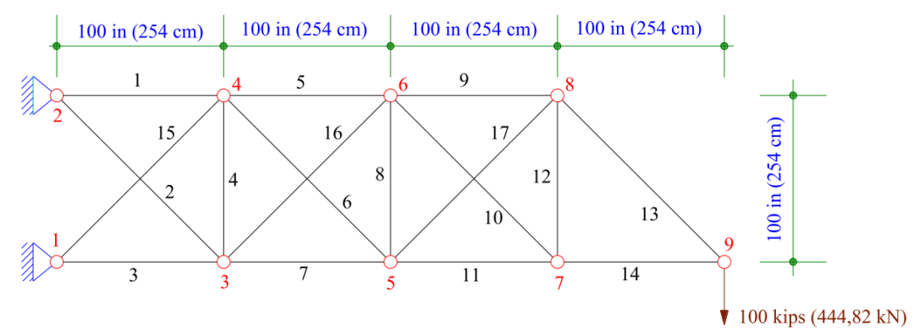
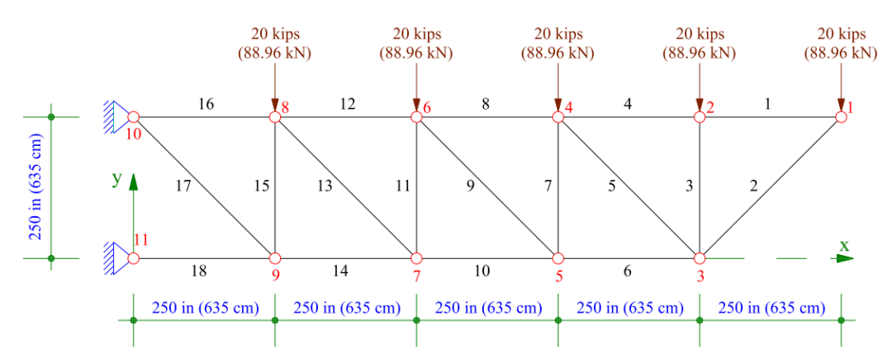
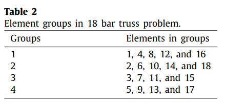
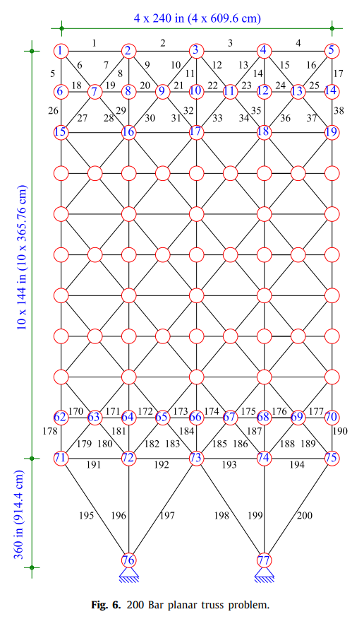
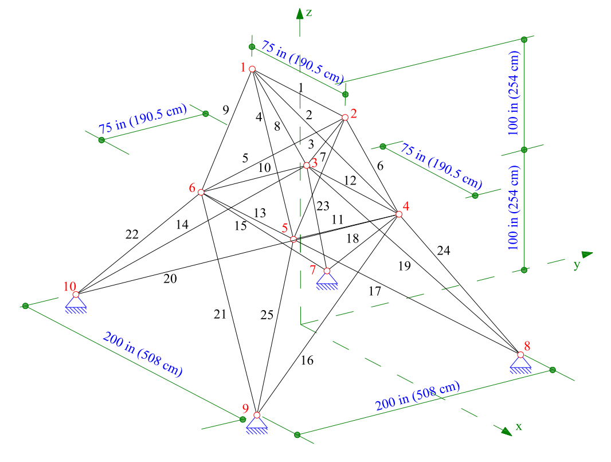
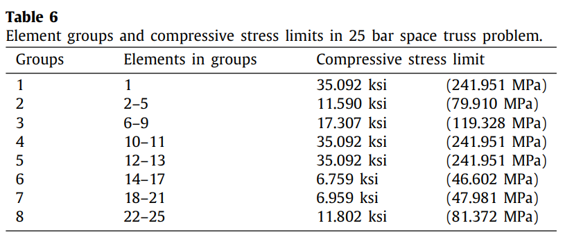
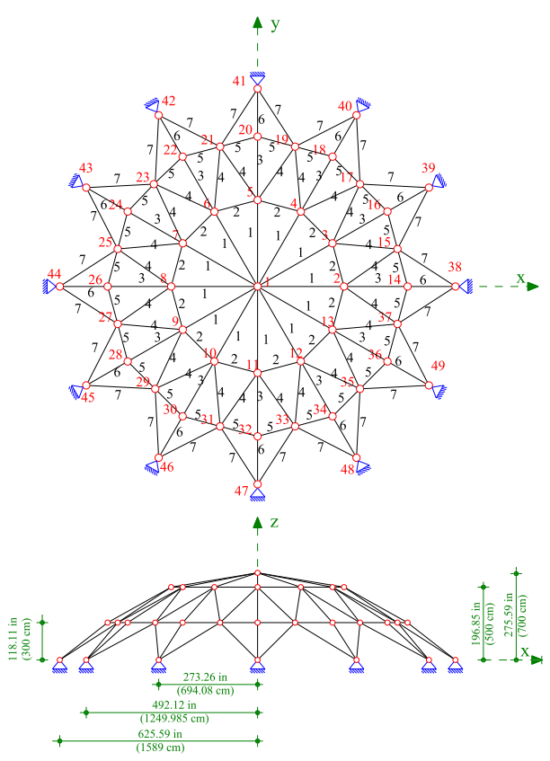
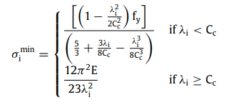
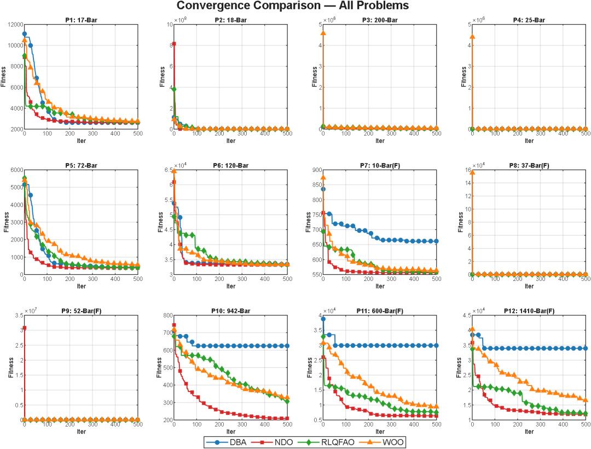
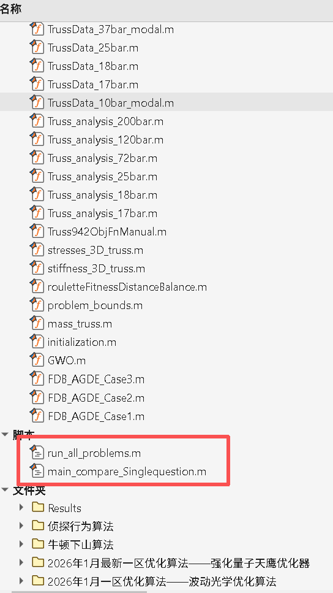

# 2026 latest optimization algorithm application case - 12 beam element problem optimization

Preface
In the field of civil engineering, trusses are ubiquitous, from the grandiose roofs of sports stadiums to the intricate frameworks of bridges, they are an integral part. Engineers have always been striving for a goal: to construct the most robust structures with the least amount of material. This not only significantly reduces construction costs but also aligns with the concept of sustainable development. 
This leads to the classic problem in structural optimization design—the truss bar problem (Truss Problems, TPs). Its objective is generally to minimize the weight of the structure under conditions of stress, displacement, and frequency constraints.
Traditional methods struggle with this multi-constraint, nonlinear challenge of truss optimization, neither being able to derive gradients nor easily stuck in local optima. Optimization algorithms, however, do not require gradient information and can search globally, as well as flexibly handle complex constraints such as stress, displacement, and frequency.
Main Text
This issue will choose several new algorithms launched in 2026 to compete on the truss bar problem! Let's take the four new algorithms shared with you recently:
January 2026 latest optimization algorithm - Wavelet Optimization Algorithm
January 2026 latest optimization algorithm - Enhanced Quantum Hawk Optimizer
February 2026 latest optimization algorithm - Detective Behavioral Algorithm
February 2026 latest optimization algorithm - Newton's Hill Algorithm
12 Truss Bar Problems introduced:
Firstly, provide references:
Öztürk H T, Kahraman H T. Meta-heuristic search algorithms in truss optimization: Research on stability and complexity analyses[J]. Applied Soft Computing, 2023, 145: 110573.
12 Truss Bar Problems include:
Plane Truss Problem: 17-bar, 18-bar, 200-bar
Space Truss Problem: 25-bar, 72-bar, 120-bar, 942-bar
Frequency Constraint Problem (Difficult): 10-bar, 37-bar, 52-bar, 600-bar, 1410-bar
(1) 17-Bar Plane Truss
The 17-bar trusses system is shown in [42]. The goal of this problem is to minimize the structural weight. The cross-sections of the 17 bars are optimized for search. Since each bar's cross-section is independent and not grouped, there are a total of 17 design variables. The lower limit for the cross-section area is 0.1 square inches (0.645 square centimeters), and the upper limit is 50.0 square inches (322.58 square centimeters). The search is conducted within this range in continuous variable form.
As shown in the figure, node 9 bears a load of 100 kips (444.82 kN). The trusses system at nodes 1 and 2 are hinged connections. The material unit weight of the bars is 0.268 pounds/cubic inch (74.508 kN/m³), with an elastic modulus of 30,000 kips/square inch (206,842.71 MPa). The problem includes stress and displacement constraints. The maximum allowable tensile stress and compressive stress limits for the bars are both 50 kips/square inch (344.73 MPa), and all nodes have a displacement limit of ±2.0 inches (±5.08 cm).
(2) 18-Bar Plane Truss
The 18-bar trusses system is shown in the figure.
The optimization search goal for this problem is to minimize the structural weight. The design variables include the cross-sections of the divided bars (grouped into four groups) as well as the vertical and horizontal positions of nodes 3, 5, 7, and 9. There are a total of 12 design variables, including cross-sections and node positions. The bars are divided into four groups, as detailed in the table below.
The lower limit of the design variable for cross-sectional area of the member is 3.5 square inches (22.581 square centimeters), and the upper limit is 18.0 square inches (116.129 square centimeters). The lower and upper limits for the node coordinates as geometric design variables are given in Table 3. Continuous variables are used for searching within these intervals. As shown in the figure, nodes 1, 2, 4, 6, and 8 are subjected to a load of -20 kips (88.96 kN). The system connects at nodes 10 and 11 with hinged supports. The material of the member has a unit weight of 0.1 pounds per cubic inch (27.801 kN/m³) and an elastic modulus of 10,000 kips per square inch (68,947.573 MPa). The problem includes stress and displacement constraints. The maximum allowable tensile stress and compressive stress in the member are limited to 20 kips per square inch (137.895 MPa), and the displacement limits for all nodes are ±1.0 inch (±2.54 cm). Additionally, the Euler buckling compressive stress in the member is calculated using formula (6).
σᵇ = -kEA / L² (6)  
Among them, k is a coefficient depending on the cross-sectional geometry. In this study, k is taken as a constant value of 4. In addition, E, A and L respectively represent the elastic modulus of the material, the cross-sectional area of the member and the length of the member.
(3) A 200-bar truss system with 200 bars, as shown in the figure.
In this problem, 200 bar elements are divided into 29 different cross-section groups. Therefore, the optimization task is to search for 29 different bar cross-section areas to minimize the structural weight. The lower limit of the cross-section area is 0.1 square inches (0.645 square centimeters), and the upper limit is 20.0 square inches (129.032 square centimeters). This range is used for continuous variable search. The structure is subjected to three different load cases, and it is checked whether each case meets the stress limit. These three load cases are given in Table 5. The system connects at nodes 76 and 77 with a hinge support. The unit weight of the bar material is 0.283 pounds per cubic inch (78.678 kN/m³), and the elastic modulus is 30,000 kN/square inch (206,842.71 MPa). The problem only contains stress constraints. The maximum tensile stress and compressive stress limits for bars are 10 kN/square inch (68.947 MPa).
(4) 25 Bar Space Truss
The 25-bar space truss system belongs to a spatial structure.
In this problem, 25 bar elements are divided into 8 different cross-section groups as shown in the table below. Therefore, the optimization goal is to search for these 8 different bar cross-section areas to minimize the structural weight.
The lower limit of the cross-section area is 0.01 square inches (0.0645 square centimeters), and the upper limit is 3.4 square inches (21.9354 square centimeters). Searching within this range is done in the form of continuous variables. The structure is subjected to two different load cases, and it is checked whether each case meets the stress limit. The truss system connects at nodes 7, 8, 9, and 10 with hinge supports. The unit weight of the bar material is 0.1 pounds per cubic inch (27.801 kN/m³), and the elastic modulus is 10,000 kN/square inch (68947.573 MPa). The problem only contains stress constraints. The maximum tensile stress limit for bars is 40 kN/square inch (275.790 MPa). For each group of bars, the compressive stress limit is provided in the table.
(4) 120-bar space truss
The 120-bar trussed system also belongs to the category of spatial structures.
In this problem, 120 beam elements are divided into 7 different cross-sectional groups according to the drawings. The goal is to search for the 9 different beam cross-sectional areas to minimize the structural weight. The lower limit of cross-sectional area is 0.775 square inches (5 square centimeters), and the upper limit is 20 square inches (129.032 square centimeters). The search is conducted in a continuous variable range within this range. At node 1, a load of 13.49 kilograms (60 kilonewtons) is applied, at nodes 2 to 14, a load of 6.744 kilograms (30 kilonewtons) is applied, and the remaining free nodes apply a load of 2.248 kilograms (10 kilonewtons) in the negative Z direction. The truss system has hinged connections at nodes 38 to 49. The unit weight of the beam material is 0.288 pounds per cubic inch (80.067 kilonewtons per cubic meter), and the elastic modulus is 30,450 pounds per square inch (209,945.36 megapascals). The problem includes stress and displacement constraints. The displacement of free nodes is limited to ± 0.1969 inches (± 0.50 centimeters). The ultimate tensile stress is calculated using the following formula.
Others not involved in the chassis will not be elaborated here again, and the code has been well integrated, unifying all issues through a unified interface function.
.rtcContent { padding: 30px; } .lineNode {font-size: 10pt; font-family: Menlo, Monaco, Consolas, "Courier New", monospace; font-style: normal; font-weight: normal; }%% Settings% Select Problem% 1 : 17  Bar Planar Truss Problem% 2 : 18  Bar Planar Truss Problem% 3 : 200 Bar Planar Truss Problem% 4 : 25  Bar Space Truss Problem% 5 : 72  Bar Space Truss Problem% 6 : 120 Bar Space Truss Problem% 7 : 10  Bar Truss Problem with Frequency Constraint% 8 : 37  Bar Truss Problem with Frequency Constraint% 9 : 52  Bar Truss Problem with Frequency Constraint% 10 : 942 Bar Space Truss Problem% 11 : 600 Bar Truss Problem with Frequency Constraint% 12 : 1410 Bar Truss Problem with Frequency Constraintproblem_type = 10;switch problem_type    case 1        ObjectiveFunction = @(Indi) Truss_analysis_17bar(Indi);    case 2        ObjectiveFunction = @(Individual) Truss_analysis_18bar(Individual);    case 3        ObjectiveFunction = @(Individual) Truss_analysis_200bar(Individual);    case 4        ObjectiveFunction = @(Individual) Truss_analysis_25bar(Individual);    case 5        ObjectiveFunction = @(Individual) Truss_analysis_72bar(Individual);    case 6        ObjectiveFunction = @(Individual) Truss_analysis_120bar(Individual);    case 7        ObjectiveFunction = @(Individual) Truss_modal_analysis_10bar(Individual);    case 8        ObjectiveFunction = @(Individual) Truss_modal_analysis_37bar(Individual);    case 9        ObjectiveFunction = @(Individual) Truss_modal_analysis_52bar(Individual);    case 10        ObjectiveFunction = @(Individual) Truss942ObjFnManual(Individual);    case 11        ObjectiveFunction = @(Individual) Truss_modal_analysis_600bar(Individual);    case 12        ObjectiveFunction = @(Individual) Truss_modal_analysis_1410bar(Individual);end\n  
Algorithm Comparison
For 12 problems, the results of running 4 algorithms are as follows:
Wavelet Optimization Algorithm (WOO), Reinforcement Learning Quantum Hawk Optimizer (RLQFAO), Detective Behavior Algorithm (DBA), and Newton's Downhill Optimization Algorithm (NDO)
Code directory is as follows:
There are two scripts that can be run. main_compare_Singlequestion.m is for running each problem individually, and run_all_problems.m is for running all problems at once. All other functions are not required to be changed!

## Images

<!-- PAYMENT_BLOCK -->

## Get this dataset

- Payment link (Stripe): [Buy now](https://buy.stripe.com/3cs8yP7sY87d0vu9AB)
- Payment QR code: 

<!-- /PAYMENT_BLOCK -->
